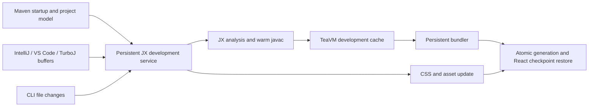

# JX starter and fast development plan

24 November 2026; functional-component priority revised 26 November. Status: **⬜ planned**. These are product requirements and a
proposed technical approach, not delivered commands or measured performance.
Implementation tasks are tracked in the [GA task list](ga-tasks.md).

The functional-first amendment was accepted in [PR #88](https://github.com/lmrrcc/jx/pull/88)
as `99bb84c`, on tested head `25a36c7`. The local 20-step gate passed in 464 seconds;
both [PR Verify](https://github.com/lmrrcc/jx/actions/runs/45872302417) and
[push Verify](https://github.com/lmrrcc/jx/actions/runs/45872200338) passed.
This publishes the requirements and ordering; ST/HR implementation and latency
qualification remain planned.

JX must let a developer create a complete Java React and Spring application in
minutes, see a small working example immediately, and edit it with rapid browser
feedback. The first experience must exercise the same build and runtime that a
larger application uses. The starter and fast development path are release
requirements, not optional IDE conveniences.

### Functional components are the default

Luca clarified on 26 November that the intended experience is React + Vite with
functional components. In JX, `@Component` with a static `render` method and
`Hooks` is that model: the Java class is its source container, not a native React
class component. Use this form in the starter, tutorial and ordinary hot-update
examples. Existing `ClassComponent`/`PureComponent` APIs and their qualified
runtime behavior remain available.

The default development contract preserves compatible functional hook state.
Editing the usual Counter must retain its count, not silently reset it. Hook
signature/schema incompatibility needs an explained reset; compile errors retain
the last good running app. Native class components may remount when refreshed.
Vite's React plugin enables [Fast Refresh](https://github.com/vitejs/vite-plugin-react/blob/main/packages/plugin-react/README.md),
whose [state-preservation decision](https://github.com/react/react/blob/main/packages/react-refresh/src/ReactFreshRuntime.js)
rejects class types. This is the experience to qualify, not a claim that JX already
implements Vite's update mechanism or timing.

Advanced preservation of native class state, including hidden Activity and
SCU-false ownership, remains an optional later R-28-04 extension after ST/HR.
This supersedes the earlier request to make that extension a starter prerequisite.
It does not complete R-28-04 or accept unsupported React runtime behavior.
The remaining React runtime parity and G0 proofs still precede ST/HR.

## 1. The first application

The default starter opens one simple page: a JX welcome screen, a local counter,
and a name field that calls a real Spring greeting operation. It demonstrates
components, props, hooks, events and CSS without introducing a database, external
service or handwritten application JavaScript. Show loading, success, validation
failure and retry. The counter still works with networking disabled; the backend
panel must report the failed request rather than fabricate a server response.

Keep the first `App.jx` small and readable. The page tells the developer which file
to edit and shows a compatible hot update retaining counter state and input focus.
Use functional `@Component`, static `render` and `Hooks` with current Java syntax;
getting started does not wait for the
separate DX-01/DX-02 language proposals. Keep the existing counter conformance
example intact, including the separately pending decision about its heading.

Maintain **one canonical template** consumed by both the repository's welcome
example and the Maven generator. Testing a richer handwritten example while
shipping a different template does not qualify the starter.

The generated project has a root Maven Wrapper and three clear boundaries:

| Module | Ownership |
| --- | --- |
| `contract` | Shared request/response values, operation definition and portable Java rules; the neutral authority for generation, with no Spring or browser-runtime dependency. |
| `web` | Java/.jx components, browser entry point, styles/assets and generated browser codecs/client; depends on the portable contract, never on Spring or persistence. |
| `server` | Spring Boot API, generated server binding, server validation and static delivery; packages the built web assets in its executable JAR. |

The contract/codec work depends on M1-17–M1-19 and M2-01–M2-04. Do not copy the
current Todo's handwritten endpoint strings, JSON fields and duplicated models
into the starter. Changing the greeting contract once must regenerate both sides
and pass an actual browser/server round trip.

## 2. Creation and startup

Proposed UX, **not currently available**; `VERSION` means a published, qualified
JX version, not a value to paste literally:

```sh
mvn -B dev.jx:jx-maven-plugin:VERSION:create -DgroupId=com.example -DartifactId=my-app -Djx.template=spring
cd my-app
./mvnw jx:dev
```

The public path permits at most these three commands, including changing
directory. No framework checkout/build, separate backend terminal, manual proxy
configuration or POM editing. JDK 25, a bootstrap Maven installation, and supported
Node.js/npm are explicit prerequisites for the initial profile (qualify Node 22
first and pin the supported range in the template). A project cannot use its
wrapper before it exists.
Generate `mvnw` and `mvnw.cmd` for subsequent use. A separately distributed wrapper
bootstrap may be added later; it is not implied by the `create` goal.

Node/npm remain framework build tools. Validate the supported versions and make
locked npm-package installation part of the one-command startup, with actionable
failures; do not ask the application author to wire npm scripts. Include a project
lockfile and never search an ancestor framework checkout for tools. A managed
Node distribution requires its own checksum, proxy and platform qualification;
it is not part of the initial profile, which requires Node/npm already installed.

Extend the existing Maven plugin with a project-independent `create` goal,
declaring `requiresProject=false`. Maven exposes this capability in its
[Mojo annotation](https://maven.apache.org/plugin-tools/maven-plugin-annotations/apidocs/org/apache/maven/plugins/annotations/Mojo.html).
Bundle versioned templates in the plugin artifact. Validate coordinates, package
names and destinations; reject existing non-empty destinations, path traversal
and symlink escapes. Generate atomically, leave unrelated files untouched, and
print the exact next commands. Interactive and non-interactive creation must
produce equivalent projects. Generation itself must not execute template code.

The root `jx:dev` starts one application session, not one server per reactor
module. It owns backend and frontend readiness, chosen ports, logs, failure
reporting and shutdown. Use one browser-visible origin: the proposed default is
Spring fronting development UI assets, matching M2-09. API errors, missing assets
and authentication routes must not become an HTML SPA fallback. Print the URL
only when both sides are ready; stop only child processes owned by this session.
An occupied port must produce an explicit alternative or a useful error.

For the first template, the greeting is an explicitly public demo operation with
no stored user data. Do not call that template authenticated. The separate
application security profile requires M1-21 and M2-09/M2-10 session, CSRF and
logout/expiry tests; no disabled security controls or wildcard credentials policy
may be used to make the example work.

`./mvnw verify` must build and test the generated application. Its executable Boot
JAR must serve UI and API after being copied to an empty directory, using only
the declared Java runtime. It must not need Maven, npm, the source tree, development
ports or absolute paths at runtime.

Public onboarding depends on GA-09 artifact distribution. A test can first use a
temporary candidate repository with fresh Maven/npm caches. “Works after installing
the entire JX reactor locally” is only a development prerequisite, not acceptance
of the public three-command experience.

## 3. Why the current update path needs work

Source inspection at `14d913a` shows the following avoidable or potentially
avoidable work. These observations identify measurement points, not measured
shares of the total delay.

| Stage | Current behavior |
| --- | --- |
| Detection | [DevMojo](../jx-maven-plugin/src/main/java/jx/maven/DevMojo.java) scans/hashes watched files, sleeps 250 ms and debounces for 300 ms. |
| Build | Every edit starts a new Maven `package`/`verify` subprocess. Generation, semantic checking and Java compilation have overlapping work. |
| Browser compilation | Counter/Todo do not enable TeaVM's incremental mode. Java compilation is only one stage before JavaScript is usable. |
| Bundling | [BrowserMojo](../jx-maven-plugin/src/main/java/jx/maven/BrowserMojo.java) starts fresh esbuild processes for vendor and application bundles. |
| Delivery | [The development client](../jx-maven-plugin/src/main/resources/jx-dev-client.js) polls for a new generation every 500 ms. |
| Editor | [IntelliJ development service](../tooling/intellij/src/main/java/jx/intellij/JxDevelopmentService.java) saves documents and launches Maven; it does not submit live buffers to a compiler service. |

The historical 5.16-second package observation in [status](status.md) is not a
current edit-to-paint benchmark. Instrument the full path before choosing the
dominant optimization. The TurboJ pattern worth transferring is a long-lived
compiler, coalesced versioned changes and in-memory bytecode. Its current source
uses JDT for syntax analysis and javac for bytecode; JX need not replace javac to
adopt that pattern.

## 4. Proposed persistent development service

Maven remains the authoritative dependency/build configuration and production/CI
path. At development startup, resolve the effective model, reactor graph, Java
toolchain, processors and dependency classpaths once. Start an isolated JVM that
owns the compiler session; reuse it until relevant configuration changes. Do not
start Maven for each ordinary Java/.jx edit.



The editor integrates directly with this service rather than repeatedly launching
Maven. Prefer process isolation over loading project compilers, processors and
TeaVM inside the IntelliJ JVM: it separates project JDK/classpath, memory, crashes
and lifecycle, and lets VS Code and the CLI share the fast path. An implementation
ADR must confirm the transport and process contract after the prototype; this
plan does not supersede the existing editor or hot-state decisions.

| Boundary | Required behavior |
| --- | --- |
| Source snapshots | Immutable workspace revision with per-file versions, contents and add/delete/rename events. Unsaved overlays are session-scoped and never overwrite disk. Explicit ownership prevents two IDE clients from silently mixing conflicting buffers. |
| Scheduling | One active build and one replaceable pending revision per session. Cancel obsolete work where supported; otherwise discard its result. Never publish mixed revisions or stale diagnostics. |
| JX and javac | Reuse compiler/file-manager infrastructure and cache analysis by source/dependencies. Invalidate dependants on API, generic type, constant and annotation changes. Remove stale generated classes on deletion/rename. Share one coherent semantic result instead of independently lowering twice. |
| TeaVM | Evaluate the pinned incremental APIs and development caches. Reuse the expensive compiler state where supported; materialize bytecode/cache files when required by supported APIs. Do not promise an entirely memory-only pipeline before proving it. |
| Bundling | Reuse a bundler context; cache React/vendor by lockfile and configuration. CSS and compatible image updates skip Java and TeaVM; HTML shell, bootstrap, entry-point and vendor changes may need a controlled restart/reload. Add/delete and lazy entry changes update the complete dependency graph. |
| Publication | Build into a candidate generation, then atomically publish only the newest successful result. Keep the last good app on failure and map diagnostics to the submitted `.jx` revision. Notify the browser immediately, with bounded reconnect/poll fallback. |
| Spring | Frontend-only changes do not restart the backend. Backend-only changes use a separately owned restart/reload path. Contract changes rebuild both dependants and expose no mismatched UI/API generation. Do not promise arbitrary JVM structural hot swap. |
| Configuration | JDK, POM/profiles, dependencies, processors, generated-source configuration and npm lockfile changes trigger model refresh and explicit cache invalidation/restart. Unsupported plugin effects use a visible Maven fallback, never stale output. |

For contract changes, coordinate frontend/backend readiness and use a contract
version guard before activating the new pair. Cancel or drain old in-flight work
where possible; already-open tabs must reject incompatible operations with a
useful version/restart message. A request whose server outcome is unknown must
not be replayed. Incompatible state schemas cause an explained reset. Test old
tabs, in-flight mutations and backend startup failure during this transition.

TeaVM documents development incremental caches and their production optimization
tradeoff in its [Maven guide](https://www.teavm.org/docs/tooling/maven.html), and
an embedded compiler serving JavaScript from memory in its
[IDEA development server guide](https://teavm.org/docs/tooling/idea.html).
These establish a route to investigate, not drop-in compatibility with JX state
transfer. esbuild's [rebuild API](https://esbuild.github.io/api/#rebuild) supports
retaining a build context; the framework-owned adapter must dispose it when the
session closes.

## 5. Editor integration and correctness

IntelliJ sends document snapshots and displays versioned build status/diagnostics
while its native Java services continue to provide completion, navigation,
refactoring and inspections. Compilation never runs on the UI thread or holds an
IDE read lock for the duration of a build. Short snapshots, cancellable background
work and disposal follow the supported
[IntelliJ threading model](https://plugins.jetbrains.com/docs/intellij/threading-model.html).
VS Code and TurboJ use the same typed, versioned service protocol; no parallel
compiler implementation is maintained inside each extension.

Start with saved changes, then qualify a visible live-preview mode for coherent
unsaved buffers. Invalid intermediate syntax keeps the last successful page.
Report which revision the preview represents; disk builds and CI always use saved
sources. Workspace trust is required before executing project tools. Stop/dispose,
trust revocation, service crash and project switching close owned processes and
invalidate overlays. Bound source/message sizes, retained revisions and caches;
authenticate any local service endpoint and validate workspace paths. No source
contents or secrets are logged by default.

Preserve [decision 0003](decisions/0003-state-preserving-development.md): a rebuilt
TeaVM generation gets new Java identities. Transfer only compatible typed
checkpoints; never pass old objects or closures into new code. Keep one React
vendor runtime, effect cleanup, cancellation, focus preservation and no replayed
HTTP mutations. Compatible functional hook state must survive ordinary edits;
an unchanged Counter resetting is a failure. Incompatible hook/schema changes
produce an explained reset. Class remount is the planned default refresh behavior;
advanced class-state preservation remains a separate optional extension. Existing
explicit class-checkpoint contracts are not removed or reclassified as complete.
Lazy-module
generations must also obey [decision 0005](decisions/0005-lazy-module-boundary.md)
and have a bounded retention strategy. A full reload used to recover from resource
limits must be reported, not counted as state-preserving hot reload.

The fast path changes development execution, not Verify or release requirements.
Clean Maven builds remain the reference. Compare diagnostics and observable
behavior after API changes, renames, deletes, errors and cache invalidation;
incremental success must never hide a clean-build failure.

## 6. Measurement and acceptance

These are **initial targets to validate**, not performance claims. HR-01 records
hardware, JDK/TeaVM/Node/browser versions, project revision, source size, build
settings and cache/network conditions before adopting a regression budget.
Use the starter, Todo and a 100-component fixture; report p50, p95 and maximum
over at least 30 scripted edits per category after five warm-up edits. Record
separate cold starts; do not mix them into warm-update statistics.

| Journey | Proposed target and proof |
| --- | --- |
| First application | At most three commands with prerequisites installed; first interactive page plus successful Spring call within five minutes on a named reference machine/network with empty project caches. Report download and build time separately. Public artifacts must be available. |
| Cached startup | First full-stack page within 30 seconds on the same fixture with dependencies cached. Backend readiness is included. |
| Warm CSS change | Edit-to-visible-style p95 at most 200 ms on the starter, without Java/TeaVM work or component remount. |
| Warm Java/.jx change | Edit-to-committed-browser-frame p95 at most one second on the starter and at most two seconds on Todo/100-component fixture; no Maven subprocess or backend restart for source-only UI edits. |
| Unsaved IDE preview | Same end-to-end budgets, including document debounce and queueing; invalid/superseded snapshots never appear. |
| Reliability | At least 100 updates with retained compatible functional hook state, cleanup, no duplicated roots/listeners or replayed requests; generation/cache counts remain bounded and heap retention is recorded. Include a Counter count/focus witness, compile-error recovery retaining the old app, and separately identified class-remount behavior. |

Capture timestamps for edit receipt, detection/debounce, queue, lowering, javac,
TeaVM, bundle, publication, browser receipt, checkpoint restore, React commit and
next painted frame. Use local monotonic clocks plus a correlated browser
acknowledgement to avoid subtracting unrelated clock origins. Timing the compiler
alone is insufficient. Benchmark isolated from mutation runs; establish normal
variation before enforcing CI latency thresholds. A missed target remains open
work; any revised target needs an explicit recorded decision.

The final generated-consumer test runs outside the JX checkout, with fresh caches
and only declared prerequisites/candidate artifacts. It exercises the browser
counter, real API round trip, validation, server failure/recovery, source edits,
packaged-JAR startup from an empty directory and process cleanup. Then repeat the
documented workflow from clean IntelliJ and VS Code profiles. The welcome example,
generator, fast service and editor paths must all use the same tested implementation.

## 7. Implementation order

Luca's 26 November clarification retains React runtime parity and all G0 proofs
first, then the functional starter and fast development service. Advanced native
class-state preservation is scheduled after those deliverables as an optional
extension; it no longer blocks their start. Add the browser welcome example and
measure the current loop (ST-01, HR-01), using the qualified shared-contract/Boot
proofs to implement the independent template and generator. In the development
track, remove unnecessary asset work, prove a persistent compiler session, then
add TeaVM/bundler reuse and IDE buffers. This supersedes the earlier proposal to
start ST/HR after an individual parity task, while applying the explicit later
exception for advanced native class checkpoints.
The first persistent-service task must already compile and update a real fixture
without launching Maven for each edit. A daemon skeleton, or a service that only
launches the existing build command, does not meet HR-03 acceptance.

Work remains one reviewed PR at a time. ST/HR tasks refine GA-12/13/24–27 and
M2-08/M2-09/M7-04 rather than creating a duplicate delivery count. M1-28's existing
editor latency proof remains part of G0; new HR implementation follows G0. The
public starter belongs to the M2 application skeleton, not first appearing at M7. Wider release
qualification still depends on G0/G1 and GA-09. The task list owns status; all new
slices start **⬜ planned**.
