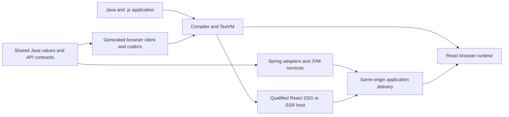
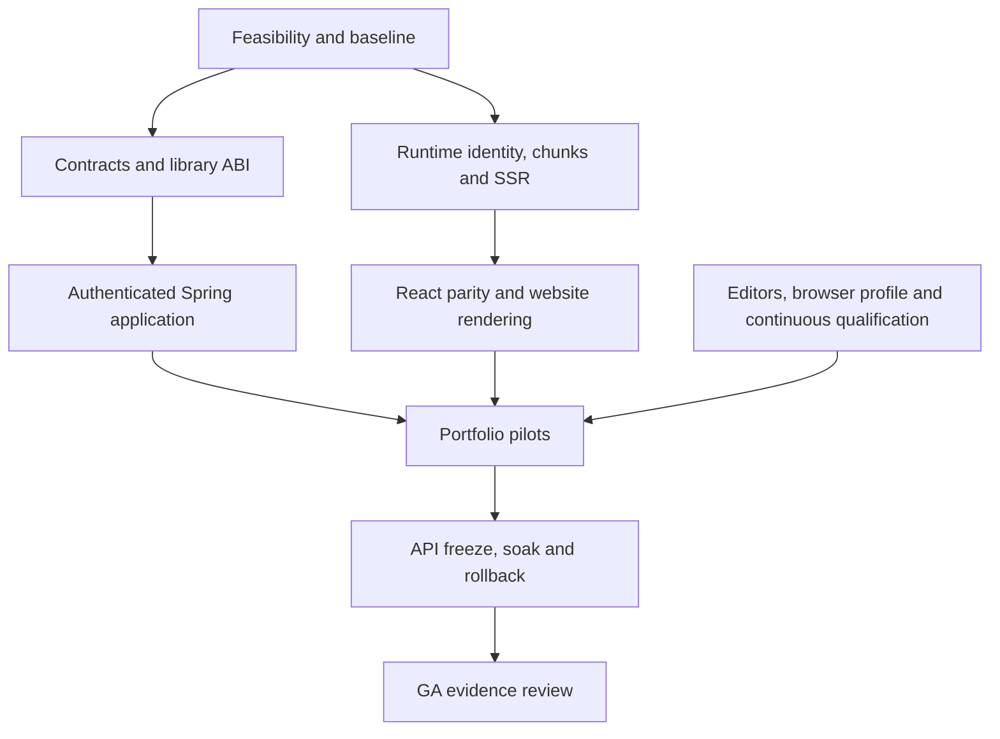

# JX general availability roadmap

Version: **0.3 — interaction evidence**, 25 November 2026. Original plan: 19 November 2026.
Original evidence baseline: repository commit `78c9836`; IntelliJ 0.3.2, VS Code 0.2.0,
Java 25, TeaVM 0.16.0, React/React DOM 19.3.1. These are observed pins, not a
promise to freeze upstream dependencies for a year.

Product requirement added 24 November 2026: the
[starter and fast development plan](ga-developer-experience.md) requires a small
React-style first example, a Maven `create` goal for an independent Java/.jx and
Spring application, one-command development startup and rapid state-preserving
updates. ST-01–ST-06 and HR-01–HR-10 in the [task list](ga-tasks.md) are all planned.
The compiler/service topology and subsecond targets are proposals to validate,
not delivered functionality or measured performance.

## Progress flags — 25 November 2026

**✅ Done · 🟡 Partial · ⬜ Planned / to do · ➡️ Next · ⛔ Blocked.**
Flags apply to the stated acceptance scope, not merely to the existence of code.
Every task in the [implementation sequence](ga-tasks.md) and every work package
in the [execution register](ga-execution.md) has an explicit status.

Latest exact-value acceptance: **✅ M1-18 merged in PR78 as `07290dd`**, after all 15 local gate steps passed in 385 seconds and both Verify checks passed on `70a01ee`. The final integration passes **197 JVM, 47 runtime Chrome, 975 conformance checks with 217 mode exclusions, four real Spring Todo scenarios and four hot workflows**. Twelve shared vectors preserve long/decimal precision and missing versus null through the real HTTP boundary. The explicit adapters remain separate from the bounded generated codec; richer schemas, generated clients and protocol evolution remain open.

Earlier shared-contract acceptance: **✅ M1-17/M1-19 merged in PR77 as `8ea78ba`**, after the 15-step gate passed in 374 seconds and both Verify checks passed on `0c0784a`. The final integration passes **195 JVM, 47 runtime Chrome, 975 conformance checks with 217 mode exclusions, three real Spring Todo scenarios and four hot workflows**. One portable record and its operation paths are shared; the generated codec supports required String/bool/int. Exact values are the next separate slice; generated clients, richer schemas and protocol evolution remain open.

Earlier route acceptance: **✅ M1-16 merged in PR76 as `515f2c2`**, after the 15-step gate passed in 339 seconds and both Verify checks passed on `226f1b4`. The final integration passes **187 JVM, 47 runtime Chrome, 975 conformance checks with 217 mode exclusions and four real hot workflows**. The 149 cases and 62/6328 pair count are unchanged. Shared cancellation and owned resources remain accepted in PR73/75; shared Spring contracts are the next prepared slice.

Earlier resource acceptance: **✅ M1-15 merged in PR75 as `f4b87ba`**, after the 15-step gate passed in 366 seconds and both Verify checks passed on `74ee92e`. The final integration passes **187 JVM, 45 runtime Chrome, 975 conformance checks with 217 mode exclusions and four real hot workflows**. The 149 cases and 62/6328 interaction count are unchanged. Cancellation remains accepted in PR73 and the bounded class journal in PR74; route loading is prepared separately.

Earlier published journal integration: **975 checks pass, 217 skipped,
149 cases**, with 180 JVM checks, 39 runtime Chrome checks and four real hot
workflow checks. All **62/6328** registered interaction pairs pass; **6266**
remain without complete evidence. Broader class/hot/editor qualification keeps
R-28 **🟡 partial**.

**✅ PR74 merged as `ae8cdca`** after the 15-step gate passed in 406 seconds
and both Verify checks passed on `4c02583`. This accepts the bounded commit
journal, connected-owner correlation and explicit nullable/sparse codec slices.
Pure checkpoints, hidden own commits, complete incoming ownership and validation
before old-root teardown remain open. The earlier three direct journal mutants
and separate nullable-reset mutant remain scoped evidence. **✅ PR73 shared
cancellation merged as `d9151c0`**; defaults remain accepted in PR72. Resource and
route loading are prepared next. Earlier measurements below describe their own slices.

Responsive image preload options (R-31-01) pass the integrated bench over
merged lifecycle authoring `338872c`: **903 checks, 169 skipped, 134 cases**,
plus 15 reporter checks. Package checks pass 47 core / two React option /
52 compiler / 15 Maven tests. The browser selects responsive candidates, reuses
equivalent links and obeys the requested referrer policy. Both scoped preload
mutants were killed after a passing baseline. The seven-argument constructor
remains available; the expanded record shape is documented. PR #59 merged as
`a805810` after the 15-step gate passed in 436 seconds and both Verify checks
passed on `4af20f2`. No new pair evidence or cross-browser qualification is
claimed. That preload run retained 54 /6,328 interaction pairs.

Earlier resource-header qualification: **🟡 partial**, with package
47 core/7 React/52 compiler/15 plugin and **911 full-bench checks, 193 skipped,
138 cases** passing. Eight explicitly asserted header/resource pairs bring this
candidate's evidence to **62/6328**, leaving **6266** active pairs open. This run
also includes the fresh resume-nonce consumer. Both scoped header mutants were
killed after a passing baseline; publication gates remain pending. This result precedes the subsequent class-policy
integration; the combined tree awaits qualification. Earlier slice measurements
below remain historical.

R-29's runtime utilities add eight implemented feature rows: awaited asynchronous
`act`, loaded runtime versions, raw development owner stacks and legacy batching.
The integrated run over class authoring `3e1db97` passes 847 checks with 169 inapplicable
cells; its eight rows expand the active universe to 113 features and 6,328 pairs.
The same 54 witnessed pairs leave 6,274 open, plus 575 deferred-feature pairs in
the unchanged eventual 6,903-pair universe. These utility cases grant no automatic
interaction credit. Deep Java owner-stack diagnostics and server-cache refresh
remain explicit open tasks. All four scoped utility mutants were killed after
the baseline passed, with zero survivors or unusable mutants. The utilities
merged in [PR #52](https://github.com/lmrrcc/jx/pull/52) as `8fdbed0` after the
15-step local gate and both Verify checks passed on `f0b5a5b`.
The `.jx` class-authoring PR #50 is merged as `3e1db97`.

Native class context (R-28-03a) now passes the integrated bench over `8fdbed0`:
**855 checks, 169 skipped, 128 cases**, including eight context cells and all
24 previous class cells. Pair evidence stays **54 / 6,328**, with no automatic
credit from the new consumer. Package checks pass 37 core / 48 compiler /
15 Maven tests; the captured-context mutant was killed after a passing baseline
on runtime/fixture source identical after rebase. Context merged in PR #53 as
`198c0b8` after its 15-step gate and both Verify checks passed on `30a8911`.
Derived/error lifecycle, class editor qualification and
committed class hot checkpoints remain separate work.

Derived state from props (R-28-03b) passes **879 integrated checks, 169 skipped,
131 cases** over functional merge `adcf22b`, with all 40 class cells green. Package
checks pass 42 core / 48 compiler / 15 Maven tests. It adds no pair witness.
The dropped-derivation mutant was killed after a passing baseline, with zero
survived/unusable. PR #55 merged as `84eb8cd` after the 15-step gate and both
Verify checks passed on `021bc02`.

Native error lifecycle (R-28-03c) passes **887 integrated checks, 169 skipped,
132 cases**, with all 48 class cells green. Package checks pass 47 core /
48 compiler / 15 Maven tests. A tightened check of the exact error-report
sequence passes all eight projects. It adds no pair witness; the scoped reporting
mutant was killed after a passing baseline, zero survived/unusable. PR #57 merged
as `6ebfc76` after the 15-step gate passed in 342 seconds and both Verify checks
passed on `baa2da5`.

Direct lifecycle authoring (R-28-03d) passes **895 integrated checks, 169 skipped,
133 cases**, including all 56 class cells. Package checks pass 47 core / 52
compiler / 15 Maven / 10 LSP tests; its strict error-report assertions pass eight
focused projects. Its compiler mutant was killed after a passing baseline on
byte-identical source in the scoped candidate campaign. PR #58 merged as `338872c`
after the 15-step gate passed in 352 seconds and both Verify checks passed on `0011c1d`.
This does not qualify the native IDE distributions or add pair witnesses.

Typed next-context policies (R-28-03e), including the generated `.jx` overload,
pass **911 integrated checks, 169 skipped, 135 cases** on responsive-preload
base `a805810`. Package tests pass 51 core / 2 React / 53 compiler /
15 Maven / 10 LSP checks;
all 64 class cells pass. Pair evidence remains 54/6328. Both scoped mutants were
killed after a passing baseline in the seven-mutant `f49b48f` campaign, with
zero survived/unusable. PR [#60](https://github.com/lmrrcc/jx/pull/60) merged as
`3815001` after the 15-step gate passed in 373 seconds and both Verify checks
passed on `251aaa7`.

Nullable direct class patches (R-28-03f) merged in
[PR #61](https://github.com/lmrrcc/jx/pull/61) as `a93e325`. The final integrated
gate passes **919 checks, 169 skipped, 136 cases**, including all 72 class cells;
the scoped callback-dropping mutation was killed after a passing baseline. All
15 gate steps passed in 348 seconds and both Verify checks passed on `1c23a22`.
Pure custom policies merged in [PR #62](https://github.com/lmrrcc/jx/pull/62)
as `39dd3ce` after the full local 15-step gate passed in 311 seconds and both
Verify checks passed: 927 bench checks, 169 skipped, 137 cases and all 80 class cells. Its
scoped policy mutant was killed after a passing baseline; remaining class options,
native editor qualification and class hot checkpoints are still open.

| Work | Flag | Remaining acceptance |
| --- | --- | --- |
| GA-01 baseline and GA-02 portfolio inventory | ✅ Done | Maintain evidence as implementation changes. |
| React parity track / GA-18 | 🟡 Partial | Local header/resume slice passes 911 checks across 138 cases and 62/6328 pairs before subsequent class-policy integration; 6266 active and 575 deferred-feature pairs remain. Final header publication gates remain pending. Class runtime slices are merged through PR62. Complete remaining APIs, options, class qualifications, Flight and combined scenarios. |
| R-28 Java class runtime | 🟡 Partial | Runtime, direct authoring and lifecycle slices are joined by nullable state, native defaults and the bounded checkpoint journal through PR74 after green gates and both Verify checks. The latest integrated bench passes 975 checks and the runtime suite passes 39. Native editor qualification, remaining class options, Pure/hidden checkpoints, complete incoming ownership and candidate preflight remain open. |
| R-31-01 responsive preload options | ✅ Done | PR #59 merged as a805810 after the 15-step gate and both Verify checks; integrated 903-check bench and both targeted mutants pass. Chrome evidence only; the broader R-31 parity gate remains open. |
| R-16 actions | ✅ Done | The `useFormState` alias and its bench case were added on 23 November 2026. |
| R-19 root options | ✅ Done | Error callbacks and identifier prefix, added on 23 November 2026. |
| R-20 server rendering to a string | ✅ Done | `ReactServer.renderToString` and `renderToStaticMarkup` in a Node host (M1-24), added on 24 November 2026. |
| R-21 hydration | ✅ Done | `React.hydrate` over Node-rendered HTML (M1-25), store server snapshots and matching `useId`, added on 24 November 2026. |
| G0 foundation proofs | 🟡 Partial | Lazy-module boundary and basic SSR→hydration proofs delivered; 100-component IntelliJ latency and closed-file structural rename locally qualified with explicit SDK undo limit (M1-28/29, publication pending); component JAR, exact shared contract, authenticated packaged Spring and protected SSR data route remain. |
| Shared contracts and complete Spring integration | 🟡 Partial | Shared Todo record/paths, generated String/bool/int browser codec and explicit long/decimal/missing/null vectors locally verified with real Spring/Chrome. Generated richer schemas/clients, starter/BOM, packaged UI/API and authenticated development remain. Publication pending. |
| JX server rendering and hydration | 🟡 Partial | Node rendering, hydration, streaming/resume have bench evidence; request isolation, protected data and the RSC protocol track remain. |
| IntelliJ and VS Code experience | 🟡 Partial | Existing packages work within documented limits; GA qualification, scale, remaining editing actions and browser debugging are open. |
| TT-01 Cherry Test orchestration | 🟡 Partial | Unit coverage/CRAP delivered; integration and browser kinds still open. |
| TT-04 PIT through Cherry Test | ⛔ Blocked | Installed Cherry Test update and first verified PIT run. |
| Production pilots and GA release | ⬜ To do | Complete platform gates, qualify pilots, then pass RC/release evidence gates. |
| React-style welcome and full-stack Maven creation | ⬜ To do | ST-01–ST-06: canonical example, one shared API contract, independent generated app, one dev command, standalone Boot JAR and clean-consumer onboarding. |
| Fast compiler service and live editor buffers | ⬜ To do | HR-01–HR-10: measure the loop, retain compiler state, incremental TeaVM/bundling, CSS fast path and shared IntelliJ/VS Code/TurboJ integration. Existing checkpoint hot reload is the baseline. |

Execution order confirmed by Luca on 24 November: continue through complete React
parity and G0, then the JX/Spring starter and faster hot reload. R-27-01 and
R-27-02a–02c merged with green Verify; Children landed in [PR #39](https://github.com/lmrrcc/jx/pull/39)
at `413558b636679dd5926f4d7bf1c987ea707ed95c`.
The ref slice landed in [PR #40](https://github.com/lmrrcc/jx/pull/40) at
`15c0c6eee36f506910e854c568547ebc6d3758ea`, with its scoped mutant killed and green
[CI](https://github.com/lmrrcc/jx/actions/runs/45452120669) and
[CI](https://github.com/lmrrcc/jx/actions/runs/45452801956).
R-27-02c's complete local bench reports 779 passes and 133 skipped cells across
114 case IDs. Its six portal pairs prove context, real DOM identity, event phases,
payloads, focus and cleanup. Its unmutated baseline passed and its scoped mutant
was killed (1 killed, 0 survived, 0 unusable); Verify passed.
The portal begins closed during SSR and opens in the browser after hydration;
this does not prove server rendering of an open portal.
Portal [PR #41](https://github.com/lmrrcc/jx/pull/41) merged as `a0f5460`, with
[green CI](https://github.com/lmrrcc/jx/actions/runs/45461059543) and
[green CI](https://github.com/lmrrcc/jx/actions/runs/45460586560).
R-27-03a adds four action-state pairs with 787 full-bench passes, 133 skipped cells
and 115 case IDs: client 113 reference / 112 JX, hydrate 88, static 94 and lazy 99
per side. Its eight focused checks pass, including queued payloads and previous
state, form status/reset, rejected successors and fresh ownership after retry or
unmount. The cancellation logic is local to the fixture, not the G0 API.
Its unmutated scratch baseline passed, then `combined-action-queue` killed
`action-queue-previous-lost` (1 killed, 0 survived, 0 unusable).
[PR #43](https://github.com/lmrrcc/jx/pull/43) merged as `1ba8c1d`, with
[green CI](https://github.com/lmrrcc/jx/actions/runs/45480919951) and
[green CI](https://github.com/lmrrcc/jx/actions/runs/45480798051).
R-27-03b adds three optimistic/store pairs with 795 full-bench passes, 133 skipped
cells and 116 case IDs: client 114 reference / 113 JX, hydrate 89, static 95 and
lazy 100 per side. Its eight focused checks pass. The scenario proves remote
snapshot rebasing, rejected-request rollback, one committed item during a pending
retry, and explicit owner disposal during both awaits. Disposal is fixture-local;
it does not deliver the G0 cancellation API. Its unmutated baseline passed, then
`combined-optimistic-store` killed `optimistic-duplicate-overlay` (1 killed,
0 survived, 0 unusable). [PR #44](https://github.com/lmrrcc/jx/pull/44) merged as
`3e24edb`, with [green CI](https://github.com/lmrrcc/jx/actions/runs/45548420721)
and [green CI](https://github.com/lmrrcc/jx/actions/runs/45548370606).
That slice's catalog has 109 entries; the historical full campaign remains 100.
R-27-03c adds three transition pairs with 803 full-bench passes, 133 skipped cells
and 117 case IDs: client 115 reference / 114 JX, hydrate 90, static 96 and lazy 101
per side. Its eight focused checks pass. Urgent input remains responsive, replaced
and canceled consumers settle independently of transport, and unmount/remount
isolates old work. An already settled result cannot publish after its owner changes;
the test observes the old transition's completed UI before awaiting the replacement.
Ownership is fixture-local, not the G0 cancellation API. After the shared scratch
baseline passed, `combined-transition-cancel` killed `transition-owner-guard-lost`
(1 killed, 0 survived, 0 unusable). The exclusive run used `abfb24a` in scratch
`jx-mutation-1181316345297598843`, with identical transition source to rebased
`d89e23f`. PR #45 merged as `812a27a` after the full local gate and both Verify
checks passed. This slice's catalog has 110 entries; the shared
run's 112 includes later SSR cases. The historical full campaign remains 100.
The [interaction evidence record](ga-react-interactions.md)
keeps executed witnesses separate from remaining and deferred-feature pairs.
R-27-03b, R-27-03c and R-27-04 are merged.
R-27-04 passes 809 checks with 151 skipped across 120 case IDs: client 118
reference / 117 JX, hydrate 90, static 96 and lazy 101 per side. Its four new
witnesses prove early bytes in actual Node Writables, isolation while one request
aborts, deduplicated preload hints and retained server nodes after hydration.
A reproduced fatal-shell defect now rejects both readiness consumers instead of
leaving `allReady()` pending. The three scoped SSR mutants were killed after a
passing baseline. [PR #47](https://github.com/lmrrcc/jx/pull/47) merged as
`7759933` after the full local gate and green
[push CI](https://github.com/lmrrcc/jx/actions/runs/45555926188) and
[PR CI](https://github.com/lmrrcc/jx/actions/runs/45556004135). These
proofs do not complete authenticated SSR G0 M1-26 or arbitrary loader cancellation.
The Promise prerequisite merged as `f2b64cb` in
[PR #42](https://github.com/lmrrcc/jx/pull/42), with
[green CI](https://github.com/lmrrcc/jx/actions/runs/45467245368) and
[green CI](https://github.com/lmrrcc/jx/actions/runs/45466911060):
nine Promise tests, 36 runtime-package JVM tests and 13 runtime browser checks
pass, together with its full local gate and CI. The eventual
118-feature / 6,903-pair universe includes 1,443 additional deferred-feature pairs
after R-28-01 activates `PureComponent`;
the scope is not reduced to the initial scenarios. Cross-browser and human
qualification, and explicit applicability decisions, remain recorded requirements
that the Chrome automated results do not satisfy.

R-28-01's integrated local run passes **825 checks, 151 skipped, across 122 case
IDs**: client **120 reference / 119 JX**, hydrate **92** per side, static **98**
and lazy **103**. Both class cases pass all eight projects. The native class
runtime delegates queues, shallow state merging, commit snapshots, refs and
`PureComponent` comparison to actual React class instances. Two explicit
PureComponent/key and PureComponent/ref witnesses bring the current total to
**54 / 5,460**, leaving **5,406** active pairs open across 105 active features.
It uses typed explicit descriptors and ordinary Java `Views`; `.jx` class authoring,
native editor semantics and advanced lifecycle/context options remain later
slices. That initial runtime reset class state; the later bounded journal is
now published in PR74 while full class checkpoint qualification remains open. All three targeted class mutants were killed after the baseline passed,
with no survivors or unusable mutants; the local 14-step gate and both Verify
checks passed before PR #48 merged as `ccfcb2d`. That runtime slice's catalog
has 115 entries, while the historical full campaign
remains 100. See [ADR 0006](decisions/0006-java-class-components.md).

R-28-02a adds direct class authoring in `.jx`: generated typed schemas, immutable
partial patches, lifecycle descriptors and checked class tags/refs. Its integrated
run passes **833 checks, 151 skipped, across 123 case IDs**: client **121 reference /
120 JX**, hydrate **93** per side, static **99** and lazy **104**. All eight focused
projects pass. Pair evidence remains **54 / 5,460** with **5,406** active pairs
open; this compiler consumer adds no pair credit. The first authored subset uses
direct, non-generic classes and nested record props/state, with field-type limits
listed in ADR 0006. Native IDE qualification remains separate; advanced lifecycle/
context options and class state preservation are still open. The compiler snapshot
mutant was killed after the unmutated baseline passed, with no survivors or
unusable mutants; PR #50 merged as `3e1db97` with the 15-step gate and both Verify
checks green.
The catalog has 116 entries, separate from the historical full campaign of 100.

Progress, 21 November 2026: [GA-01](ga-01-baseline.md) is done, with CI green at
`3688d25`. It found `78c9836` red in CI (counter example), restored a
green baseline and added the [baseline record](evidence/baseline.md),
[version manifest](evidence/versions.tsv) and [capability ledger](evidence/capabilities.tsv).

Progress, 21 November 2026: [GA-02](ga-02-portfolio.md) is done. It registered
21 browser surfaces and 40 journeys, measured
the deployed public sites and three production bundles in the
[portfolio baseline](evidence/portfolio-baseline.md), and recorded Luca's decisions:
website pilots `lmrr.cc`, `stacktrace.cc` and `luca4j.com`; application pilot Stack
Sensei as a separate implementation with one-to-one behavior and no change to the
existing site.

Progress, 23 November 2026: the [status review](status.md#progress-review--23-november-2026)
reconciles source, the feature register and CI through code revision `2667d2c`.
The React track has 19 complete tasks; the R-16 gap that review found (the
`useFormState` alias) was closed the same day. There are 93 supported/equivalent feature
rows out of 120; the bench records 86 JX passes, 11 unsupported cases and one
not-applicable case. These are coverage counts, not a GA completion percentage.
Update, 24 November 2026: R-19 to R-25 are done. The feature register has 104 supported/equivalent
rows out of 120 and none unsupported. R-26 adds the lazy-route axis to the existing
client, hydration and static HTML modes. Luca's try-it run confirmed 715 passes
and 133 inapplicable cells; revision `eb5a18a` passed
[Verify](https://github.com/lmrrcc/jx/actions/runs/45372691183), completing R-26.
See the [task and try-it command](ga-tasks.md#react-parity-track).
M1-22/M1-23 proved the serialized lazy-module boundary; automatic chunk packaging
in the Maven plugin is still open. G0 also needs component JARs, exact shared
contracts, authenticated packaged Spring and the protected SSR data route (M1-26).
Milestone dates have not been advanced or declared complete
because client React work reached features originally assigned to M2/M3.

Revision, 21 November 2026: implementation now follows the
[implementation sequence](ga-tasks.md), an ordered list of change-sized tasks
grouped by these milestones. Each task adds code with a check that Luca runs before
the next one starts. Milestone dates and gates below are unchanged.

Decision, 21 November 2026: JX is proven first against a purpose-built React test
bench (reference React and JX versions of each case, one shared spec, every stable
React export mapped), described in the implementation sequence. Existing products
are later pilots, not the starting point.

Scope change, 21 November 2026: the target is support for **all** React features in
JX, measured by the [feature list](evidence/conformance.tsv) (118 rows: 36 covered,
14 untested, 49 unsupported, 19 excluded on that date). The React parity track in the
implementation sequence assigns every open row to a task. This supersedes two
statements below: section 1's limit to "stable asynchronous/form capabilities" as a
chosen subset, and the placement of React Server Components outside 1.0, which
becomes the last and largest parity item after a feasibility proof. Java typing
still applies: where a React shape is untyped, JX provides a typed equivalent with
the same observable outcome. The added scope is not yet reflected in the capacity
figures of section 8; dates stay conditional and are reviewed at each gate.

Planning horizon: **19 November 2026–19 November 2027**. GA is an evidence gate,
not an automatic consequence of reaching the last date. This document proposes
work; it does not change the accepted runtime architecture or claim implementation.

## 1. Product outcome

JX should make Java a practical authoring language for complete browser products:
React components and markup, rich interaction, shared domain logic, typed APIs,
secure backend integration, accessible user interfaces, and reliable development
and operation. A team must be able to build and maintain a substantial application
without maintaining a parallel handwritten TypeScript application or duplicating
its public API models and wire protocol.

The ultimate validation is replacing the frontends of Medusa, Gandalf, Stack Sensei
and the websites incrementally, while preserving their behavior and operations.
Framework GA and completion of every migration are **separate milestones**.
No production frontend is retired merely because JX has released version 1.0.

The one-year target has three release outcomes:

1. **JX 1.0 application profile:** complex React browser applications, shared Java
   contracts/domain rules, Spring Boot integration, backend-neutral protocols,
   installable editors, debugging and supported production delivery.
2. **JX 1.0 website profile:** static generation, React hydration, metadata,
   accessibility, routing and an explicitly qualified SSR deployment mode.
3. **Portfolio qualification:** representative production pilots and tested
   migration procedures for rich media, finance, Rust/WASM and extension hosts.
   Extension qualification is required before Gandalf's replacement, even if the
   general application release is ready first. A separate signed **G4 portfolio
   qualification gate** covers media/finance/extension readiness; passing G3 alone
   does not complete the year-one portfolio target.

### Meaning of JSX/TSX parity

The target is equivalent application capability with Java's type and execution
semantics. It does not mean copying TypeScript syntax, structural typing, arbitrary
JavaScript coercion, or every Next.js convention into Java.

Maintain an executable parity ledger for the exact React/DOM versions supported:
each capability has an idiomatic React fixture, its Java/.jx counterpart, observable
outcomes, error behavior, supported environments and a status. A runtime hook name,
successful compile or a screenshot is not evidence of parity.

The application GA profile must cover component composition, generic typed props,
children/render props, default/optional props, schema-checked prop forwarding,
keys/fragments, conditional/list rendering, controlled and uncontrolled inputs,
DOM/SVG, refs, custom hooks, context, external stores, portals, lazy routes,
Suspense, transitions, error recovery and the stable asynchronous/form capabilities
of the pinned React release. Refs and callbacks must work through third-party
bindings as well as through JX-owned components.

React Server Components and Server Functions are a distinct framework protocol,
not an automatic consequence of supporting JSX. Under the 21 November scope
decision, R-30 now includes the server-component protocol in the parity track,
with a feasibility proof and decision record before implementation. This is
unfinished scope, not delivered React Flight or Next.js drop-in compatibility.
The R-30-01 [Flight proof](../tests/rsc-proof/README.md) now executes Java server
components with the actual server-conditioned React runtime and decodes an
interactive Java client component in Chrome. Its seven Node and four browser
checks establish a narrow transport boundary, suspension/error/abort behavior
and server-source exclusion; PR #49 merged as `5fa53c0` with green local gate and
Verify. General client/server directives, server functions and production protocol
qualification remain open.
The subsequent R-30-03 cache slice has eight differential Node checks passing for
typed zero/one/two-argument functions and cache lifetime signals. It adds explicit
request isolation and cleanup evidence. Twelve differential checks additionally
prove request context through Java await/map/recovery and shared-promise observers;
one Node check preserves observer error reporting. The combined local proof has
28 Node and four Chrome passes. PR #51 merged as `a7a3f62` after the 15-step gate
and both Verify checks passed. Server functions,
directive-driven packaging, abandoned-request retention and production
qualification remain open.
Server data loading, typed HTTP mutations, SSR and hydration alone do not complete
R-30. Re-estimate capacity and dates at the gates as its feasibility becomes known.

## 2. Evidence at the starting line

The implementation already proves `.jx → Java → javac → TeaVM → React` in a real
browser. It is an executable foundation, not a production framework yet.

| Area | Evidence today | GA work still required |
| --- | --- | --- |
| Components/compiler | Typed record props, hooks, keyed children, fragments, source diagnostics | Published component libraries, generics/defaults/forwarding, complete grammar/recovery and cross-module ABI |
| React lifecycle | Actual React hooks, cleanup, external stores, error boundaries and two-way interop fixtures | Advanced concurrency/rendering APIs, broader events/refs, real ecosystem bindings |
| Applications | Counter and routed Todo with Elm, forms, HTTP and Spring persistence | Identity, permissions, complex workflows, streaming/media, offline policy and operations |
| Shared contracts | Explicit manually written JSON codecs | One canonical contract, generated clients/codecs/schema, differential serialization and evolution tests |
| Spring | Working example API | Optional supported starter/BOM, secure development, self-contained packaged application and deployment matrix |
| Browser Java | Classes reached by the current fixtures execute under TeaVM | Method-level library certification, transitive dependency checks and size/correctness budgets |
| Hot updates | Typed checkpoints, conservative resets, cancellation | Large application latency, generated codecs, foreign component/reset behavior and long-session qualification |
| Editors | Native Java integration; IntelliJ Run gutter and bounded editing services | Broader Java action parity, VS Code gaps, debugging, workspace scale, compatibility maintenance |
| Release | Source, wrappers, configured CI, local packages | Published supported artifacts, independently reproduced CI, release security, upgrade/support policies |

The recorded baseline includes 92 IntelliJ tests and a compatible Plugin Verifier
result for `IU-261.25134.95`; the earlier browser evidence is 17 Chrome tests at its
recorded revision. These numbers describe different scoped checks, not one fresh
GA certification run. See [status](status.md), [runtime](runtime.md),
[tooling](tooling.md) and [performance evidence](intellij-performance.md).

Concrete gaps that influence sequencing:

- Component metadata is currently derived from the source batch; library JAR
  consumption must work before building a reusable component ecosystem.
- The Todo DTO and its JSON field/URL knowledge are repeated on the browser and
  server. The current JSON API exposes exact `int` values, not a certified general
  numeric wire model.
- The current development proxy strips authentication/cookie headers. It is not
  evidence of authenticated Spring development.
- Spring serves the demo's external build directory. That is not proof of an
  application JAR deployable independently of the checkout.
- The current hot loader reconstructs Java values across TeaVM generations.
  Independent chunks cannot simply exchange arbitrary Java instances. This also
  constrains lazy loading, shared libraries, workers and SSR bootstrapping.
- IntelliJ uses projected/injected Java. Full structural refactoring is not
  implied by native completion. VS Code currently rejects class/file rename and
  some closed-file edits; neither editor has verified `.jx` browser stepping.

## 3. Architecture to preserve and decisions to prove

React continues to own rendering, reconciliation, hooks and scheduling. Java 25
and Maven remain the application baseline. JavaScript/TypeScript is allowed in
framework adapters, tooling and explicit bindings, not as a hidden requirement
for ordinary application business logic. Core remains independent of Spring.

These boxes are logical boundaries; create separate artifacts only where a
consumer exercises them. The required dependency direction is more important than
the initial artifact names.

### Shared code and Spring

Adopt the [shared-contract proposal](ga-contracts.md): browser-safe Java values,
pure rules and one endpoint/schema definition generate asynchronous browser
clients, codecs, server adapters and schema documentation. Existing Spring
controllers and non-Java APIs get bounded adapters into the same contract model.
Keep Spring/JPA/Jackson execution, authorization, secrets and persistence out of
the browser. Sharing a domain concept does not imply serializing an ORM entity.

Spring integration must support:

- An existing Boot application adding JX without replacing its authentication,
  controllers, transactions, logging or existing build structure; one dependency/BOM and
  documented plugin configuration rather than copied integration scripts.
- A new application created through the Maven plugin from a maintained template,
  with a simple React-style welcome example, shared contracts, client, Spring
  server, tests and useful defaults. At most three commands must reach a working
  UI/API after declared prerequisites, without cloning/building JX or manually
  wiring ports/proxies. One root dev command owns both sides. See
  [the starter plan](ga-developer-experience.md) for distribution prerequisites,
  cold/warm timing and independent-consumer acceptance.
- Existing Gradle/Kotlin Boot backends consuming Maven-built JX contracts and web
  assets, with a tested CI/IDE recipe or separately qualified Gradle adapter. No
  mandatory backend build-tool migration; JX's own application baseline stays Maven.
- One browser-visible origin in development and production. API errors remain API
  errors; SPA fallbacks never swallow `/api`, authentication, actuator or missing
  asset requests. Base paths, reverse proxies, cookies and TLS are tested.
- Production assets inside an executable Boot JAR by default for CSR/SSG; external
  CDN delivery is optional. Building requires Java/Node tooling; running the CSR/SSG
  JAR must not require Maven, npm, the source checkout or a development server.
- Session/CSRF and OIDC patterns, typed 401/403/validation/conflict errors,
  cancellation, uploads/downloads and authenticated SSE/WebSocket integration.
- An additive starter that respects user configuration and backs off correctly.
  Servlet MVC is the first supported profile. WebFlux gets a separate test matrix,
  never an inference from MVC success; target both for GA if migration demand
  confirms it at the first-month scope review.

### Fast development feedback

Preserving state is necessary but insufficient: normal Java/.jx edits should
reach the browser rapidly. Measure detection, compilation, TeaVM, bundling,
publication and React commit separately. The proposed service resolves Maven
once, retains compiler state and consumes versioned editor/file snapshots; normal
UI source edits must not start another Maven process or restart Spring. IntelliJ,
VS Code, TurboJ and the CLI share this engine while native Java editing remains
owned by each editor.

The [technical plan](ga-developer-experience.md) proposes starter p95 targets of
200 ms for CSS and one second for Java/.jx, to be validated on a named reference
machine. It preserves typed checkpoint transfer, clean Maven validation and
explicit cache invalidation. The execution order confirmed on 25 November first
completes React parity and G0, then implements the starter and fast development
service. M7 broadens editor and long-session qualification; milestone labels do
not override that dependency order.

### Browser Java standard library

Use TeaVM's class library and extension points; do not create an unbounded private
fork of `java.*`. TeaVM explicitly supports sharing some backend code but imposes
restrictions on reflection, resources, class loading and JNI. Its logical threads
are not evidence of ordinary parallel JVM threading in the browser.
See [TeaVM overview](https://www.teavm.org/docs/intro/overview.html) and
[class-library customization](https://teavm.org/docs/runtime/java-classes.html).

Create a versioned **JX browser Java profile** with method-level fixtures:

| Profile tier | Candidates and intended treatment |
| --- | --- |
| Shared foundation | Records/enums/sealed values, strings/Unicode, collections, generics, lambdas, exceptions, `Optional`, common sequential streams; certify exact methods used by shared code |
| Domain arithmetic and time | `BigInteger`, `BigDecimal`, UUID, regex, `java.time`, parsing/formatting; boundary, rounding, timezone/DST and locale comparisons against the JVM |
| Browser capabilities | Fetch, streams, files/blobs, storage, crypto, media, workers, observers, clipboard and DOM through typed adapters with browser permission/lifetime semantics |
| Explicitly conditional | Reflection metadata, service loading, resources, third-party JARs, serialization libraries, cooperative asynchronous APIs; require reachability/size and behavior evidence per version |
| Server-only | Spring/ORM/JDBC, arbitrary local filesystem/processes, JNI, dynamic class loading, blocking sockets and unqualified JVM concurrency semantics |

A compatibility report names the first unsupported reachable method and the path
from application code to it. CI rejects server-only transitive dependencies and
accidental secrets/resources. A class appearing in a TeaVM JAR is not certification.
Share pure domain calculations and reusable validators first; browser-native I/O
should expose its actual async/permission model rather than mimic blocking JVM I/O.

For every newly certified library: identical JVM/browser fixtures, error behavior,
locale/numeric cases, incremental bundle cost, supported targets, license and owner.
Contribute fixes upstream where possible; local patches need a removal plan and
bounded maintenance owner. WebAssembly GC remains an optional experiment until it
outperforms the JavaScript target for measured workloads without breaking React
interop or deployment; it is not on the critical path by assumption.

### Rendering and Java identity

Within 30 days prove a small lazy-loaded JX route sharing context, domain objects
and callbacks with the shell. Determine whether TeaVM's supported module/library
facilities preserve one compatible runtime or require an explicit serialized ABI.
Record duplicate-runtime, React singleton, chunk failure and version constraints.
Do not ship `React.lazy` wrapping unrelated TeaVM outputs as a parity claim.

Also prove real React server/static rendering of TeaVM output followed by browser
hydration. Include a protected data-dependent route, request-scoped API base/auth
context, allowlisted outbound destinations, immutable hydration snapshot, cancellation,
and no duplicate fetch/mutation. Test simultaneous identities, not only a counter.
Begin with a Node-based framework host as a candidate; compare an
embedded JavaScript host only after measuring actual compatibility and isolation.
No replacement JVM renderer. A pure-Java authoring model does not mean a JVM can
execute `@JSBody` methods directly.

CSR/SSG Boot delivery can remain a single JVM process. Request-time SSR may require
a supervised renderer process/service; its operational cost must be explicit.
Choose the mode by month 2. Require request isolation, bounded concurrency/timeouts,
safe bootstrap serialization, stable IDs, timezone/clock inputs and cache scoping.
No user data in a shared renderer singleton. Establish server snapshots for
external stores and avoid browser globals during server imports. React's
[server APIs](https://react.dev/reference/react-dom/server),
[static rendering](https://react.dev/reference/react-dom/static/prerender) and
[hydration contract](https://react.dev/reference/react-dom/client/hydrateRoot)
are distinct acceptance boundaries.

Public static pages should opt into hydration only when needed; a content page
must be able to emit HTML/CSS without loading React/TeaVM. Establish a safe parsed
content renderer or explicit sanitized-HTML capability for Markdown/rich content,
with consistent CSR/SSR handling, CSP/Trusted Types and unsafe SVG/URL tests.
The current raw-HTML rejection is not a complete rich-content solution.

Prove minimal JX packaging under actual Chrome MV3 CSP and an existing Rust/WASM
binding in M1–M2. Full extension qualification comes later, but runtime/packaging
incompatibility must be discovered early.

## 4. Workstreams and completion contracts

Each workstream needs a responsible maintainer and an independent reviewer.
Roles below are assignments to fill, not claims that a team already exists.

| ID / owner role | Deliverables | Required evidence before GA |
| --- | --- | --- |
| L — compiler lead | Grammar/recovery, generic components, explicit optional/default props, safe forwarding, child/render-prop contracts, dependency-JAR metadata and deterministic generation | Independent producer/consumer projects; compile-fail fixtures; fuzz/incomplete edits; precise source diagnostics; no generated helper leakage |
| R — runtime lead | Stable React API ledger, event/ref/DOM coverage, advanced hooks, portals, Suspense, lazy chunks, error recovery, React DevTools naming | Differential React/JX browser fixtures, Strict Mode, interrupted rendering, identity and cleanup; third-party refs/events/children |
| A — application lead | Nested routes/layouts, loaders/actions, resource/cache invalidation, optimistic rollback, forms, errors, virtualized lists, i18n | Authenticated multi-route reference product with deep links, concurrent edits, stale responses, offline recovery and keyboard/screen-reader tasks |
| C — contract lead | Shared values/rules, codecs/clients/schema generator, API compatibility checks and published contract artifacts | Real Boot↔browser cross-version tests; exact money/IDs/time/nullability; existing controller and non-Java backend consumers |
| S — Spring lead | Starter/BOM, template, packaged assets, same-origin dev, security, streaming, health and configuration | Start packaged app in clean directory/container; authenticated Playwright journey through actual Spring Security; hostile payload and tenant isolation tests |
| J — compatibility lead | Browser Java profile, dependency scanner, selected library certification, workers and async contracts | JVM/browser differential tests, unsupported API diagnostics, bundle budgets and migration-required libraries |
| T — tooling lead | IntelliJ/VS Code parity backlog, TurboJ native support, debugger maps, Run/Debug configuration, hot workflow | Install released packages on clean profiles; source breakpoints and stack traces; safe rename/import/format/undo across closed files; latency/memory tests |
| W — rendering lead | SSG, SSR host, hydration, metadata, route splitting, assets/images/fonts and SEO | HTML meaningful without JS; matching hydrated tree; request isolation; cache/security/status correctness; website pilot |
| Q — release lead | CI, platform matrices, security, performance, artifacts, documentation and support | Reproducible release candidate from tag; clean consumer install; signatures/checksums/SBOM; upgrade and rollback rehearsal |
| M — migration lead | Inventory, conformance corpus, pilots, coexistence/rollback and rollout evidence | Product owner accepts equivalent workflows; monitored cohorts; independently executable rollback; no forced backend rewrite |

Application state has one owner per concern: local hooks for local interaction,
an optional Elm store for workflows, and a resource cache for remote data. Specify
invalidation and cancellation between these owners; do not copy authoritative
server data indefinitely into several unsynchronized stores. No mandatory global
store or Spring dependency for small apps.

Choose maintained React ecosystem bindings where they meet the contract before
building replacements for grids, editors, forms or resource caches. The framework
must own a coherent typed integration and lifecycle, not reimplement every npm
library. Browser storage/persistence is explicit; full offline mutation/PWA support
is an opt-in profile with idempotency and upgrade tests, not implied by offline
counter clicks.

## 5. Sequence, milestones and decision gates

Dates are targets under the capacity assumptions below. Work is parallel only
where contracts are stable enough; the dependencies in [the backlog](ga-execution.md)
take priority over calendar position.

| Window | Milestone | Exit gate and demo |
| --- | --- | --- |
| M1 · Nov 19–Dec 18, 2026 | G0: feasibility and measured baseline | Inventory and API ledger; dependency-JAR component, exact DTO round trip, thin authenticated Boot JAR/dev-origin proof, lazy-runtime ABI, data-dependent React SSR→hydrate and native editor spikes. Recorded go/change/stop decisions, baseline CI and performance corpus; start MV3/WASM spike |
| M2 · Dec 19–Jan 18 | G1: shared application skeleton | Published-local component/contract modules; generated async client; Boot JAR serves UI/API; session+CSRF dev/prod journey; numeric/date/null rules fixed |
| M3 · Jan 19–Feb 18 | Alpha 1: language and reusable components | Generic/default/forwarded props and markup recovery; selected Java profile; first external component library consumed by an independent application; signed test packages through a candidate distribution path |
| M4 · Feb 19–Mar 18 | Alpha 2: complete application workflow | Nested routes, forms/validation, resource lifecycle, optimistic failures, auth recovery, uploads and streaming; authenticated project/workflow reference app beyond Todo |
| M5 · Mar 19–Apr 18 | Alpha 3: React ecosystem and rich input | Advanced React parity tranche, modal/portal, editor/chart/grid/media bindings, accessible widgets; Stack Sensei-like streaming/media slice and Medusa-like live table slice |
| M6 · Apr 19–May 18 | G2: website and rendering alpha | SSG and qualified SSR host, hydration and route chunks; internationalized content site; meaningful HTML with JS disabled; performance budgets evaluated |
| M7 · May 19–Jun 18 | Beta 1: daily developer platform | Installed editor matrix, `.jx` debugging, broader hot-update soak, qualification of the M2 starter and observability; one low-risk pilot operating with rollback |
| M8 · Jun 19–Jul 18 | Beta 2: production pilots | Authenticated Medusa/Stack Sensei read-oriented routes plus website pilot; old/new frontends coexist; real operator incidents and upgrade feedback incorporated |
| M9 · Jul 19–Aug 18 | Beta 3: portfolio edge cases | Finance precision, media permissions, Rust/WASM and extension-host qualification; Gandalf read-only pilot; reconnect, background lifecycle and offline tests |
| M10 · Aug 19–Sep 18 | RC entry: feature/API freeze | Mandatory parity ledger complete; security/performance/a11y review; framework/wire compatibility freeze; independent consumer and migration rehearsals |
| M11 · Sep 19–Oct 18 | RC stabilization | At least 30 days representative pilot operation; browser/IDE/OS matrix green; recovery and version-skew drills; release docs/support complete |
| M12 · Oct 19–Nov 18 | G3: GA decision; G4: portfolio qualification | Separate sign-offs for application/website GA and media/finance/extension qualification; clean-room install, rollback, reproducible artifacts and publication rehearsal; explicit go/no-go review on Nov 19, 2027 |

Critical dependencies:

### Stop/change rules

- If dependency-JAR component metadata is unsound, stop ecosystem expansion and
  fix the compilation contract. Consumer source copying is not an acceptable fix.
- If code splitting cannot maintain safe Java identity, choose and test a supported
  module ABI or change the backend strategy through an ADR. Do not weaken ordinary
  Java type guarantees to meet a date.
- If real React SSR cannot be isolated safely, website GA remains blocked for
  request-time rendering; SSG-only sites may pilot under a narrower explicit profile.
- If editor latency or generated edits remain unsafe, reduce structural features
  under a documented capability contract while correcting the architecture. Do
  not advertise full Java parity or silently lose the user's requested capabilities.
- If capacity is insufficient, move dates or explicitly renegotiate scope. Never
  compensate by dropping authorization, precision, rollback or compatibility tests.

## 6. Measurable GA qualification

The full test matrix, budgets, failure drills and evidence rules are in
[GA qualification](ga-qualification.md). Minimum release conditions:

1. Every mandatory capability has a runnable consumer and green checks on its
   supported targets. Unqualified features are absent from stable advertising.
2. A complex authenticated reference app deploys independently of the checkout,
   uses one public contract definition, and passes two-user/two-tenant isolation,
   concurrent edit, session expiry, cancellation and recovery scenarios.
3. Public sites have meaningful initial HTML, correct metadata/status/canonical
   URLs, hydration without unexpected replacement, accessibility and field budgets.
4. Supported React, TeaVM, JDK, Boot, browser, IDE, Node-build and OS versions are
   pinned in a release manifest. Unsupported combinations fail with useful guidance.
5. No unresolved release-blocking correctness, security or data-loss issue. Remaining
   lower-priority limitations are visible, owned and have tested workarounds.
6. Source, binary, wire, generated metadata, hot-checkpoint and deployment compatibility
   policies are separate and enforced. Old tabs against a new backend are tested.
7. A clean consumer can install from published artifacts, develop, test, package,
   deploy, diagnose and upgrade using documentation alone. Maintainer-local caches
   and preinstalled workspace dependencies cannot be required.
8. At least one complex authenticated application and one public website pass a
   30-day operational pilot and rollback exercise. Gandalf requires its additional
   extension gate; this is not inferred from a website passing.

## 7. Portfolio migration strategy

The initial [portfolio inventory](ga-migrations.md) is based on local source
inspection, not product-owner sign-off. It includes non-Spring backends and
extension hosts; JX must remain useful with those existing systems.

Recommended order is by workflow risk, not by project prestige:

1. A static/content site or noncritical isolated route; prove delivery, SEO,
   accessibility and reversible routing.
2. A read-only authenticated dashboard or settings area in Medusa/Stack Sensei;
   prove sessions, typed contracts, rendering and observability.
3. CRUD/workflow routes with optimistic concurrency, streaming and rich forms;
   add Stack Sensei media and payments only after their dedicated qualification.
4. Gandalf read-only views with existing Rust/WASM protocol boundaries; qualify
   extension lifetime/CSP/storage/messages before privileged user flows.
5. Trading, wallet signing, financial submission and other irreversible actions
   last. Require exact numeric tests, existing backend security rules, explicit
   confirmation semantics and product-specific review before any cutover.

Use route-level coexistence first; embed JX in existing React only where both can
share compatible React packages and root ownership. Cross-root values use versioned
contracts, not opaque objects from independent TeaVM runtimes. Keep URLs, sessions,
analytics and persisted preferences stable. Compare outcomes against the old UI;
never duplicate state-changing requests for a shadow comparison.

For each route maintain feature flag, backend/API version range, old/new asset
versions, cache/service-worker behavior, operator, monitoring window and rollback
command. Preserve the old frontend until acceptance and rollback rehearsals finish.
Shared backend schema changes use expand/contract migrations; a frontend rollback
must not require destructive database rollback. No migrations or deployments are
authorized merely by writing this plan.

## 8. Capacity, governance and daily iteration

Planning assumption: a product/technical lead plus approximately **four sustained
engineering workstreams** (compiler/runtime, contracts/backend, tooling, product/
qualification), with part-time security, accessibility and design review. People
can span roles; autonomous agents can accelerate implementation and evidence
collection but do not supply production sign-off or on-call ownership.

At 46 productive weeks, four engineers provide roughly 184 engineer-weeks before
review/support allocation. Reserve at least 30% for integration, defects, upstream
changes, documentation and release work. This is a capacity model, not a validated
effort estimate. Estimate the first month's backlog after its spikes. With one
maintainer plus agents, treat the full portfolio schedule as aspirational and
review it monthly; do not promise all migrations in one year.

The [execution plan](ga-execution.md) provides dependency-ordered work packages,
the first 30 days and a daily review record. Use one version-controlled backlog
and one evidence ledger; issue trackers may mirror IDs but must not fork truth.

- Daily: review failures/feedback, choose one measurable slice, implement/test,
  capture evidence, update risks and next action. A study day may end in a useful
  rejected design, not necessarily merged code.
- Weekly: demo an end-to-end consumer, inspect flaky tests and performance trends,
  review compatibility/security changes, retire obsolete work and plan next slices.
- Monthly: review gate evidence with Luca, pilot users and maintainers; update
  capacity, dependency versions, migration order and dates. Record scope changes.
- At alpha/beta/RC/GA: explicit go/no-go with archived artifacts and blockers.

Do not schedule a year of identical implementation tasks. Keep detailed rolling
plans for 2–4 weeks and outcome-level milestones for later months. This planning
request does not create unattended daily jobs or authorize future publication.

### Decisions for the first review

Proposed defaults allow work to begin without pretending decisions are final:

| Decision | Proposed default | Deadline / consequence |
| --- | --- | --- |
| Initial release users | Java teams building Spring apps, with backend-neutral interop preserved | D7; affects template and documentation priorities |
| First pilot | **Decided 21 November 2026:** websites `lmrr.cc`, `stacktrace.cc`, `luca4j.com`; application Stack Sensei, built beside the existing frontend without modifying it. First routes are chosen when the pilots start | No production cutover yet |
| Exact parity scope | **Decided 21 November 2026:** all React features, including the R-30 server-component protocol track; only explicitly approved exclusions | Feasibility/ABI decision still required; re-estimate the critical path at the gates |
| SSR operations | CSR/SSG single Boot JAR; candidate isolated JS renderer for request-time SSR | D30–M2; require proof and operator acceptance |
| Contract authority | Java-first for new Java apps; OpenAPI/import adapters for existing/non-Java APIs | D15; no two handwritten authorities |
| Staffing and dates | Four workstreams with 30% stabilization allowance | D7 and monthly; one-year target is conditional |
| Stable support policy | One declared supported stack first; two recent browser versions; bounded IDE matrix | M1 proposal, M10 freeze; no blanket compatibility |
| Publishing identities | Verify ownership of Maven group, npm scope, editor publishers and signing process | M1; do not assume repository name grants namespace ownership |

## 9. Sources and revision discipline

Repository evidence is linked from this document and its appendices. External
references were consulted on 19 November 2026; floating documentation can show
different minor versions. Revalidate against pinned artifacts before implementation.

- [React API index](https://react.dev/reference/react): scope for the parity ledger.
- [React Server Components](https://react.dev/reference/rsc/server-components):
  distinct server/framework integration, not ordinary CSR or SSR.
- [TeaVM JavaScript interop](https://teavm.org/docs/runtime/jso.html) and
  [compiler extensions](https://www.teavm.org/docs/runtime/compiler-extensions.html):
  candidate integration mechanisms, not certification of all Java APIs.
- [Spring static resources](https://docs.spring.io/spring-boot/reference/web/servlet.html)
  and [Spring Security CSRF](https://docs.spring.io/spring-security/reference/servlet/exploits/csrf.html):
  boundaries the starter must preserve.

After every review update version/date, changed decisions, gate status, evidence
revision and next actions. Do not rewrite historical measurements as current
results. The governing [v2 specification](JX_Astra_Max_Prompt_v2.txt) and accepted
ADRs remain authoritative until an explicit decision supersedes them.
